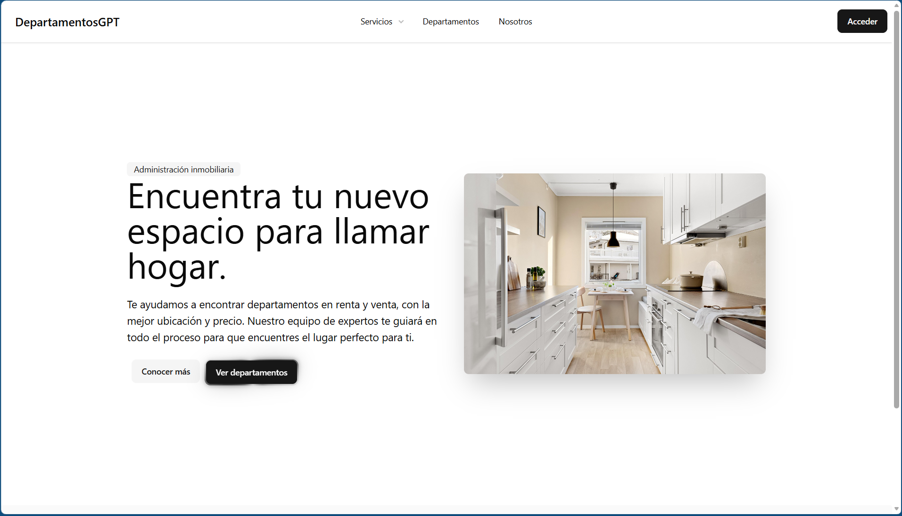

<div align="center" style="background-color: #ffffff; color: #171717;">

# DepartamentosGPT

<div align="center">
  
</div>

### Instalación

**1. Clona el repositorio**

```bash
git clone URL_DEL_REPOSITORIO
cd NOMBRE_DEL_REPOSITORIO
```

**2. Instala las dependencias**

```bash
composer install
```

**3. Configura las variables de entorno**

Copia `.env.example` y renombra la copia como `.env`. Después, configura las credenciales de la base de datos y de Google.


**4. Ejecuta el proyecto**

Inicia Apache y MySQL desde tu entorno local y abre la dirección correspondiente en tu navegador.
</div>
